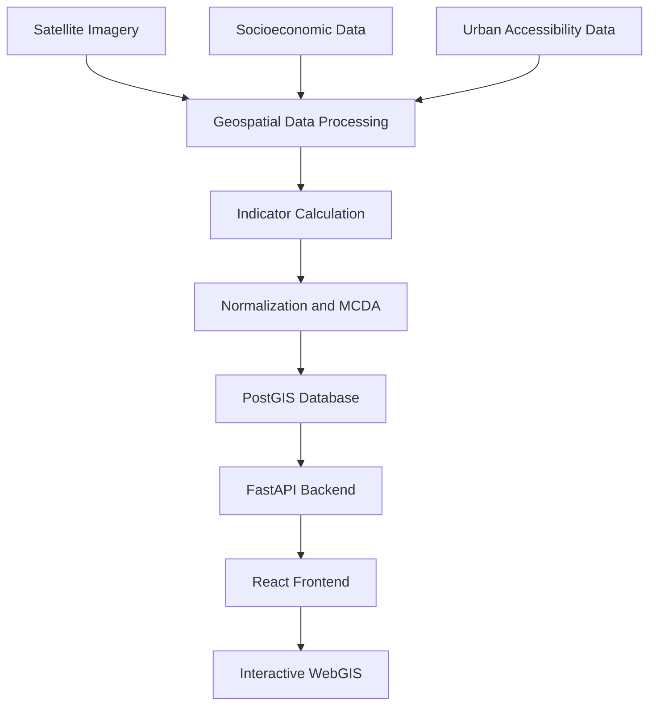

# QuoL-i Thessaloniki

### Urban Quality of Life Assessment through Earth Observation, GIS and Interactive WebGIS

## 1. Project Overview

QuoL-i Thessaloniki is a geospatial research project developed as an undergraduate thesis in Surveying and Geoinformatics Engineering.

The project focuses on the development of a composite Quality of Life (QoL) index for Metropolitan Thessaloniki, Greece, integrating socioeconomic, environmental and accessibility indicators.

The results are presented through an interactive WebGIS application, enabling users to explore spatial patterns and investigate alternative indicator weighting scenarios.

[Explore the WebGIS Application](https://repository-name-quol-i-thessaloniki.vercel.app/)

## 2. Research Objectives

- Develop a composite urban Quality of Life index.
- Integrate heterogeneous geospatial and socioeconomic datasets.
- Extract environmental indicators from satellite imagery.
- Assess spatial accessibility to essential urban services.
- Apply multi-criteria decision analysis.
- Investigate the sensitivity of the composite index to weighting variations.
- Explore spatial autocorrelation.
- Develop an interactive WebGIS application for spatial visualization.

## 3. Study Area

| Parameter | Description |
|---|---|
| Study area | Metropolitan Thessaloniki, Greece |
| Spatial units | 15 Municipal Communities |
| Reference year | 2021 |
| Coordinate reference system | EPSG:2100 |
| Total indicators | 17 |

## 4. Data Sources

- Sentinel-2 multispectral satellite imagery
- Landsat-8 thermal satellite imagery
- Population census and socioeconomic data
- Urban facilities and services
- Administrative boundaries
- Urban block spatial data

## 5. Quality of Life Assessment Framework

The composite index integrates 17 indicators organized into three thematic dimensions.

### Socioeconomic Dimension (4 indicators)

- Dependency ratio
- Tertiary education
- Labour force participation
- Unemployment

### Environmental Dimension (3 indicators)

- Normalized Difference Vegetation Index (NDVI)
- Normalized Difference Built-up Index (NDBI)
- Land Surface Temperature (LST)

### Accessibility Dimension (10 indicators)

- Sports facilities
- Primary schools
- Lower secondary schools
- Upper secondary schools
- Hospitals
- Pharmacies
- Supermarkets
- Metro stations
- Playgrounds
- Kindergartens

## 6. Earth Observation and Remote Sensing

Satellite-derived environmental indicators were used to characterize urban environmental conditions.

| Indicator | Satellite | Application |
|---|---|---|
| NDVI | Sentinel-2 | Vegetation assessment |
| NDBI | Sentinel-2 | Built-up area assessment |
| LST | Landsat-8 | Urban surface temperature assessment |

### NDVI

Normalized Difference Vegetation Index:

$$
NDVI = \frac{NIR-Red}{NIR+Red}
$$

### NDBI

Normalized Difference Built-up Index:

$$
NDBI = \frac{SWIR-NIR}{SWIR+NIR}
$$

### LST

Land Surface Temperature was derived from Landsat-8 Level-2 products to characterize urban thermal conditions.

## 7. Multi-Criteria Decision Analysis

The methodological framework incorporates the Analytic Hierarchy Process (AHP), indicator normalization and weighted aggregation.

The weighting scenario implemented in the composite index is:

| Dimension | Weight |
|---|---:|
| Socioeconomic | 41.26% |
| Environmental | 32.75% |
| Accessibility | 25.99% |

$$
QoL_i = 0.4126S_i + 0.3275E_i + 0.2599A_i
$$

Where:

- S represents the socioeconomic dimension.
- E represents the environmental dimension.
- A represents the accessibility dimension.

## 8. Sensitivity Analysis

Sensitivity analysis was performed to investigate the robustness of the composite index under alternative weighting scenarios.

The evaluation included:

- Weight perturbations of ±20%.
- Spearman rank correlation.
- Mean ranking changes.
- Maximum ranking changes.

The results indicated relatively stable rankings across the tested weighting scenarios.

## 9. Spatial Statistics

Global Moran's I was applied to investigate spatial autocorrelation in the composite Quality of Life index.

The analysis indicated weak positive spatial autocorrelation, without statistical significance at the 5% significance level.

## 10. WebGIS Application

The interactive application supports:

- Choropleth mapping
- Interactive spatial visualization
- Custom indicator weighting
- AHP-based weighting scenarios
- Dynamic legends
- Histograms
- Cumulative distribution visualization
- Radar charts
- Comparative analysis of municipal communities

## 11. System Architecture

## 12. Technology Stack

### Frontend

- React
- Vite
- MapLibre GL JS
- Chart.js
- JavaScript

### Backend

- Python
- FastAPI

### Database

- PostgreSQL
- PostGIS

### Scientific Methods

- Geographic Information Systems
- Earth Observation
- Remote Sensing
- Spatial Analysis
- Spatial Statistics
- Multi-Criteria Decision Analysis
- Analytic Hierarchy Process

### Deployment

- GitHub
- Vercel

## 13. Limitations

- Dependence on indicator selection and data availability.
- Sensitivity to normalization and weighting decisions.
- Spatial aggregation effects.
- Temporal limitations of the reference datasets.
- Limitations of the accessibility assessment methodology.

## 14. Future Research

Potential extensions include:

- Alternative normalization methods.
- Distance-decay accessibility modelling.
- Integration of additional Earth Observation datasets.
- Spatiotemporal Quality of Life assessment.
- Investigation of machine learning approaches for geospatial modelling.

## 15. Author

**Nick Chatzis**

Undergraduate Thesis — 2026

Surveying and Geoinformatics Engineering

International Hellenic University
